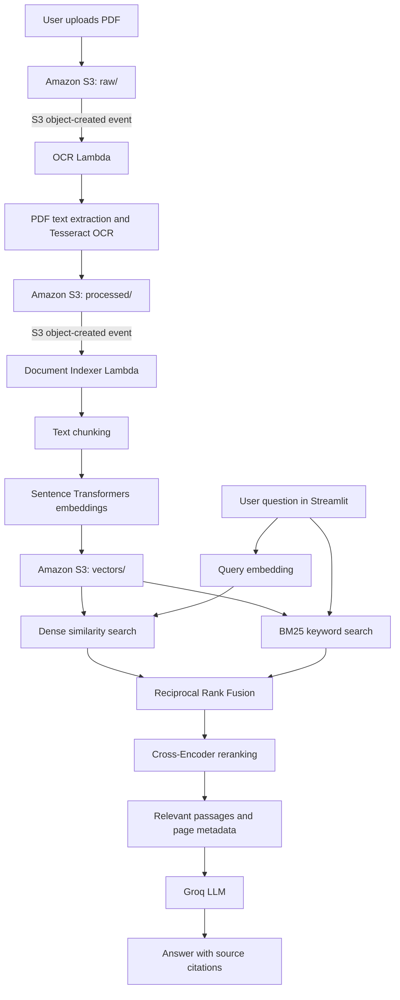

# Nullfinity — Intelligent Document Assistant

An AI-powered document processing and question-answering application built with Amazon S3, AWS Lambda, OCR, Sentence Transformers, hybrid retrieval, reranking, Streamlit, and Groq.

## 1. Project Overview

Nullfinity automates the processing of PDF documents and allows users to ask natural-language questions about their contents.

The application uploads documents to Amazon S3, automatically extracts text through an AWS Lambda OCR workflow, generates vector embeddings, and stores the indexed text and metadata in S3. A Streamlit interface retrieves relevant passages and uses a language model to generate answers with document and page citations.

## 2. Problem Statement

Business information is commonly stored in invoices, forms, scanned documents, and other PDFs. Finding specific information manually can be time-consuming.

Nullfinity provides an automated document-processing pipeline and a question-answering interface that helps users locate relevant information without manually searching entire documents.

## 3. Architecture



## 4. Technology Stack

### AWS services
- **Amazon S3:** Stores uploaded PDFs, extracted OCR output, and vector-index JSON files.
- **AWS Lambda:** Runs OCR and document indexing automatically.
- **Amazon ECR:** Stores the container images used by the Lambda functions.
- **Amazon CloudWatch:** Provides Lambda execution logs.

### Python and AI
- Python and Boto3
- Tesseract OCR and Poppler
- PyPDF and PDF processing tools
- Sentence Transformers: `sentence-transformers/all-MiniLM-L6-v2`
- NumPy and PyTorch
- BM25 keyword retrieval
- Reciprocal Rank Fusion (RRF)
- Cross-Encoder reranking
- Groq API for answer generation
- Streamlit for the user interface

## 5. End-to-End Workflow

### Step 1: Document ingestion
The user uploads a PDF through Streamlit. The application stores the original document under the `raw/` prefix of the Mumbai S3 bucket.

### Step 2: Automatic OCR
An S3 object-created notification invokes the OCR Lambda. The function extracts selectable PDF text and uses Tesseract OCR for scanned pages.

The extracted page text and associated metadata are stored under `processed/` in S3.

### Step 3: Chunking and embeddings
A second S3 notification invokes the document-indexing Lambda when an OCR output is created.

The indexer splits extracted page text into chunks and generates normalized 384-dimensional embeddings with `all-MiniLM-L6-v2`.

Each chunk retains information such as its document filename, source S3 key, page number, and chunk ID.

### Step 4: Vector storage
The indexing Lambda stores the chunks, embeddings, and metadata as JSON under `vectors/` in S3.

### Step 5: Hybrid retrieval
When a user asks a question, the application generates an embedding for the query and compares it with the stored document embeddings. It combines dense semantic retrieval and BM25 keyword retrieval using Reciprocal Rank Fusion.

### Step 6: Reranking
A cross-encoder reranks the candidate passages to prioritize the most relevant context.

### Step 7: Answer generation
The retrieved passages are sent to Groq with instructions to answer using the supplied document context. The application displays the generated answer and the corresponding document filenames and page numbers.

## 6. Project Structure

```text
Nullfinity/
├── app.py
├── README.md
├── requirements.txt
├── .env
├── src/
│   ├── embeddings.py
│   ├── rag_pipeline.py
│   ├── s3_service.py
│   └── vector_store.py
├── lambda_ocr/
│   ├── Dockerfile
│   ├── requirements.txt
│   └── lambda_function.py
└── lambda_indexer/
    ├── Dockerfile
    └── lambda_function.py
```

Other local folders and supporting modules may also be present.

## 7. Environment Configuration

Create a local `.env` file in the project root containing the required settings:

```dotenv
MUMBAI_S3_BUCKET=nullfinity-mukesh-mumbai-2026
OLD_S3_BUCKET=nullfinity-mukesh
GROQ_API_KEY=your_groq_api_key
GROQ_MODEL=openai/gpt-oss-20b
```

Replace `your_groq_api_key` with your own valid key.

Never commit `.env`, API keys, AWS access keys, or other credentials to a public repository.

The application uses the AWS credential chain through Boto3. Configure an appropriate AWS IAM role or local AWS CLI profile with the required S3 permissions.

## 8. Run Locally

### Prerequisites
- Python and pip
- Docker Desktop for rebuilding Lambda container images
- AWS CLI with appropriate permissions
- Access to the configured S3 bucket and deployed Lambda functions
- A valid Groq API key

### Activate the existing virtual environment

From the project root on Windows:

```cmd
null\Scripts\activate
```

### Install dependencies

```cmd
pip install -r requirements.txt
```

### Start Streamlit

```cmd
python -m streamlit run app.py
```

Open the local URL displayed in the terminal.

### Use the application
1. Upload a PDF.
2. Allow the OCR and indexing Lambdas to process it.
3. Refresh the AWS processing status.
4. Ask a question about the indexed document.
5. Review the answer and retrieved source passages.

## 9. Testing and Validation

The following integration checks were completed during development:

- Uploaded a sample invoice to the S3 `raw/` prefix.
- Verified that the OCR Lambda created a processed output in S3.
- Verified that the indexing Lambda created a vector JSON file in S3.
- Confirmed that generated embeddings have 384 dimensions.
- Tested loading the indexed chunks from S3.
- Tested dense similarity search and BM25-based hybrid retrieval.
- Tested Groq answer generation through the Streamlit interface.
- Observed answers with source document filenames and page numbers.

These tests validate the demonstrated invoice workflow. Additional tests should cover multi-page PDFs, different document types, empty or invalid files, duplicate uploads, and failures during OCR or indexing.

## 10. Limitations and Future Improvements

- The current embedding model runs through Sentence Transformers, while answer generation uses Groq.
- Amazon Bedrock invocation returned `Operation not allowed` during development and is not part of the currently working answer-generation path.
- The S3 vector index is loaded from JSON files during retrieval. A dedicated vector database or cached index may improve efficiency for larger collections.
- Duplicate indexing and repeated uploads should be handled carefully.
- Production deployment should include authentication, controlled access, robust error handling, and further testing.
- Additional enhancements could include document-processing status tracking, table extraction, evaluation datasets, and Infrastructure as Code.

## 11. Cost and Security

- S3 storage, ECR image storage, Lambda execution, network transfer, and external API usage may incur charges.
- Check the applicable AWS pricing and your account's free-tier or credit eligibility.
- Configure a billing budget or alert.
- Keep API keys and credentials out of source control.
- Delete unnecessary resources after the demonstration if they are no longer needed.

## 12. Conclusion

Nullfinity demonstrates an intelligent document-processing and RAG workflow using S3, Lambda, OCR, open-source embeddings, hybrid retrieval, reranking, Streamlit, and Groq.

The project automates document ingestion and indexing, and makes it possible for users to ask questions about their documents and inspect the sources used to generate the answers.